<picture>
  <source media="(prefers-color-scheme: dark)" srcset="images/header-dark.svg">
  
</picture>

  <a href="https://soz1p.github.io/jeon-sojin-portfolio/#p-eos"><b>Portfolio (KO)</b></a> &nbsp;·&nbsp; <a href="https://soz1p.github.io/jeon-sojin-portfolio/?lang=en#p-eos"><b>Portfolio (EN)</b></a> &nbsp;·&nbsp; <a href="presentation/edge-of-survival.pdf"><b>Presentation (PDF)</b></a>

    

> **핵심 기여** &nbsp; Photon PUN 2 멀티플레이와 생존 게임 로직을 구현해 2인 팀 게임을 완성했습니다.

발표자료 · 무인도와 설원 맵 구현 화면

## At a glance

| 2024.03 | 2인 팀 | Single · Multi |
| :---: | :---: | :---: |
| 학부 프로젝트 | 권상민 · 전소진 | 플레이 모드 |

## STAR

| | |
| :-- | :-- |
| **S · T** · 상황과 과제 | 무인도 조난 시나리오에서 자원 수집, 위험 회피, 탈출이 이어지는 게임을 싱글·멀티플레이 모두로 구현해야 했습니다. |
| **A** · 내가 한 일 | • **멀티플레이 환경** · Photon PUN 2 기반 네트워크 연동 • **게임 로직** · 무인도 조난 시나리오, 적 생성, 자원 수집 및 탈출 이벤트 • **UI** · 체력 바, 타이머, 나침반 디자인 및 구현 • **협업** · 스토리보드, 일정 관리, 발표자료 작성 |
| **R** · 결과 | 싱글·멀티플레이 생존 시뮬레이션 프로토타입을 완성하고, 네트워크·게임 상태·UI를 하나로 통합하는 경험을 쌓았습니다. |

## Gameplay

- 열대 섬과 설원에서 위험 요소를 피하며 자원을 모으고 나침반을 찾아 탈출합니다.
- 멀티플레이에서는 Photon 룸에 함께 접속해 같은 맵에서 미션을 수행합니다.
- 체력이 다하면 실패, 탈출 게이트에 도달하면 미션 완료 UI가 표시됩니다.

발표자료 · 핵심 기능: 멀티플레이와 위험 요소

## Code map

| 영역 | 스크립트 (`Assets/`) |
| --- | --- |
| 멀티플레이 · 런처 | `SimpleLauncher`, `IslandLauncher`, `mountainLauncher`, `ChangePlayMode` |
| 미션과 탈출 | `PlayerMission`, `MountainMultiplayerMission`, `EscapeGate`, `multiEscapeGate`, `MissionCompleteUI` |
| 나침반 | `Compass`, `multiCompass`, `multiCompassSpawn`, `cshCompassSpawner` |
| 적과 전투 | `EnemyController`, `cshEnemyController`, `cshAttackArea`, `cshBreakableObject` |
| 플레이어 · UI | `SimplePlayerMove`, `cshPlayerController`, `cshJoystick`, `HealthBar`, `cshButton` |
| 장면 | `ChangeScene`, `cshSinglePlayer`, `cshgate` |

## Team & source scope

권상민 · 전소진 (2인 팀). 설원 및 싱글플레이 환경은 공동 제작자의 담당 영역이며, 위 개인 기여는 전소진의 역할을 구분한 것입니다.

`Assets/`에는 게임플레이 C# 스크립트만 제공합니다. 외부 Unity 에셋·SDK·장면·프리팹·Photon 설정과 App ID는 포함하지 않아 코드 열람용이며 완전한 실행 프로젝트가 아닙니다. 
외부 그래픽 및 사운드 에셋의 권리는 각 제작자에게 있습니다.

---

전소진 · Jeon Sojin · Graphics Engineer &nbsp;|&nbsp; <a href="https://soz1p.github.io/jeon-sojin-portfolio/">Portfolio</a> · <a href="https://github.com/soz1p">GitHub</a> · <a href="https://www.linkedin.com/in/soz1p">LinkedIn</a> · jeonsoz1p@gmail.com
