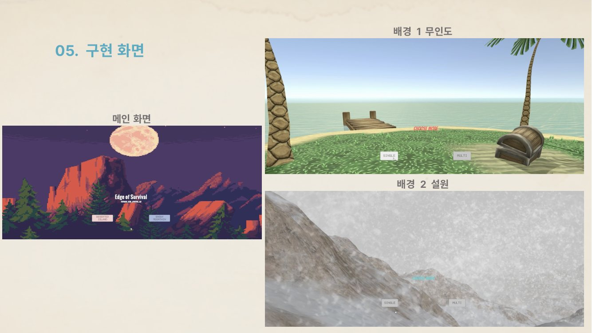
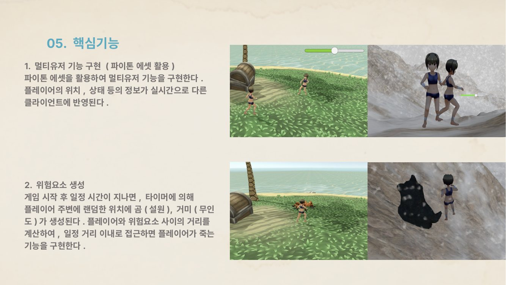

<!-- portfolio-cover-v1 -->
# Edge of Survival

**Unity · C# · Multiplayer survival simulation**

  

2024.03 · 2인 팀 · 권상민, 전소진

[**Portfolio ↗**](https://soz1p.github.io/jeon-sojin-portfolio/#projects)

열대 섬과 설원에서 위험 요소를 피하고 나침반을 찾아 탈출하는 싱글·멀티플레이 생존 시뮬레이션입니다.

학부 프로젝트 발표자료 · 기존 구현 화면

## Highlights

**Key features:** Multiplayer networking · Gameplay events · UI · Team collaboration

[Project presentation (PDF)](presentation/edge-of-survival.pdf)

## My Contributions

Photon 멀티플레이 환경, 무인도 시나리오와 적 생성·자원 수집·탈출 이벤트, 체력 바·타이머·나침반 UI, 스토리보드와 일정 관리.

## Features

- 무인도와 설원 환경의 생존·탈출 시나리오
- Photon 기반 멀티플레이 환경
- 자원 수집, 나침반과 탈출 이벤트
- 체력 바, 타이머 및 게임 결과 UI

## Team

권상민 · 전소진 (2인 팀). 설원 및 싱글플레이 환경은 공동 제작자의 담당 영역이며, 위 개인 기여는 전소진의 역할을 구분한 것입니다.

외부 그래픽 및 사운드 에셋의 권리는 각 제작자에게 있습니다.

## Source Scope

`Assets/`에는 프로젝트의 게임플레이 C# 스크립트만 제공합니다. 팀 공동 작업 결과이며 모든 스크립트를 전소진이 단독 작성했다는 의미는 아닙니다. 개인 담당 범위는 My Contributions에 구분했습니다.

외부 Unity 에셋·SDK·장면·프리팹·Photon 서비스 설정과 App ID는 포함하지 않습니다. 따라서 이 공개본은 코드 열람용이며 완전한 Unity 실행 프로젝트가 아닙니다. 발표자료는 당시 팀 결과를 기록한 문서이며 학번은 제거했습니다.
